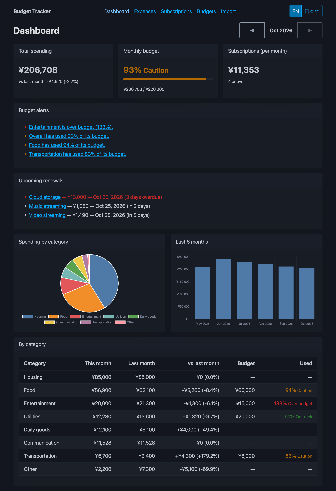
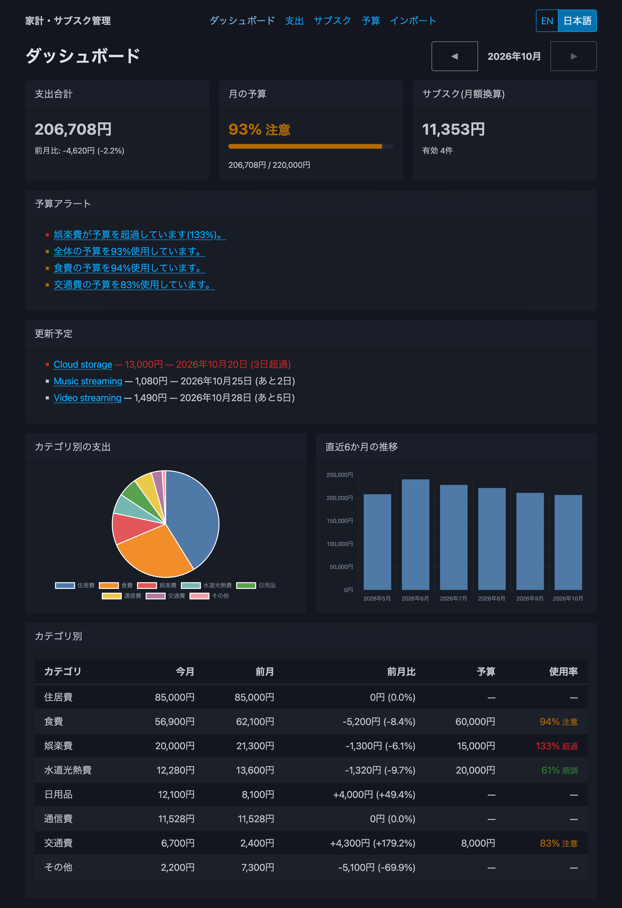

# Python-Budget-Tracker-App

**English** | [日本語](README.ja.md)

A lightweight, offline **budget & subscription tracker** built with FastAPI.
Track expenses, see where the money goes each month, catch upcoming subscription renewals, and get warned before you go over budget.
The UI is English by default and switches to Japanese with one click.

<p align="center">
  
  
</p>

This repository is a portfolio project for practicing the **detailed design → implementation → unit test → integration test** process.
Every step has its own documents, and requirements are traced through design, code and tests ([traceability matrix](docs/09_traceability.md)).

## Features

| | Feature | Notes |
|---|---|---|
| 💴 | Expenses | Add / edit / delete / list by month (date, amount, category, memo) |
| 🏷️ | Categories | 8 built-in categories + your own. Categories in use cannot be deleted |
| 🔁 | Subscriptions | Monthly / yearly, active / paused. "Renewed" moves the next date forward with month-end rules (Jan 31 → Feb 28 → Mar 31, leap days) |
| 🔔 | Renewal notices | Renewals due within 7 days, plus overdue ones, on the dashboard |
| 📊 | Monthly summary | Totals by category, month-over-month change, subscription total (monthly equivalent), pie + 6-month bar charts |
| 🚦 | Budgets | Overall and per-category budgets. **Caution at 80%**, **over budget above 100%** (exactly 100% is still caution) |
| 📥 | CSV import | UTF-8 / UTF-8 with BOM / Shift_JIS. Invalid and duplicate rows are skipped and reported by line |
| 🌐 | English / 日本語 | Text, dates (`Oct 23, 2026` / `2026年10月23日`), amounts (`¥1,200` / `1,200円`) and chart labels. The choice is remembered |
| 🛡️ | Robust storage | Single JSON file with locking and atomic writes. A corrupted file is moved aside and the app still starts |

## Tech stack

| Layer | Technology |
|---|---|
| Backend | Python 3.12, FastAPI, Pydantic v2, uvicorn |
| Frontend | HTML5, CSS, JavaScript (ES modules, no build step) |
| UI libraries (vendored, no CDN) | Alpine.js 3.17.4, Chart.js 4.5.1, Pico CSS 2.1.1 |
| API | REST + JSON, unified error format `{"error": {"code", "message", "details"}}` |
| Storage | JSON file (`data/budget.json`) |
| Tests | pytest, pytest-cov, FastAPI TestClient, Node.js built-in test runner (`node --test`) |
| Tooling | uv |

Amounts are always integers (yen). Rates such as month-over-month change are computed with `Decimal` and returned as strings (`"12.5"`), so no floating-point error reaches the screen.

## Getting started

Requirements: [uv](https://docs.astral.sh/uv/) (Python 3.12 is installed by uv if needed). Node.js is only needed to run the JavaScript tests.

```bash
uv sync

# Optional: start with sample data (Oct 2026 expenses, subscriptions and budgets)
cp data/sample.json data/budget.json

uv run uvicorn app.main:app --reload
```

Open <http://127.0.0.1:8000/>. The API documentation is at <http://127.0.0.1:8000/docs>.

- **Run a single process.** File locking is per process, so do not use `--workers` (see [DATA-01](docs/04_data_design.md)).
- "Today" is the date in **Asia/Tokyo**, whatever the server timezone is.
- Use another data file with `BUDGET_DATA_FILE=/path/to/file.json`.
- `data/*.json` (except `data/sample.json`) and `data/*.csv` are git-ignored.

### If the data file is corrupted

The app moves the broken file to `data/budget.json.corrupt-YYYYMMDDHHMMSS`, starts with empty data, and shows a banner.
The original file is kept untouched. Fix it by hand, stop the app, and copy it back to `data/budget.json`.

## CSV format

```csv
date,amount,category,memo
2026-10-01,1200,food,Lunch
2026/10/02,"3,980",日用品,Detergent
```

- Required columns: `date`, `amount`, `category`. `memo` is optional. Column order is free.
- `category` accepts a category name in English or Japanese, or a code such as `food`.
- Limits: 1 MB and 5,000 rows. Rows with the same date, amount, category and memo are treated as duplicates.

Details: [docs/06_csv_import_design.md](docs/06_csv_import_design.md).

## Running tests

```bash
uv run pytest                                  # unit + integration (304 cases)
uv run pytest --cov=app --cov-report=term      # with coverage
uv run pytest tests/unit                       # unit tests only
node --test "tests/js/*.test.mjs"              # JavaScript unit tests (32 cases)
```

## Test results

| | Result |
|---|---|
| pytest (unit 251 + integration 53) | ✅ 304 passed |
| node --test | ✅ 32 passed |
| Line coverage of `app/` | **99.9%** (unit tests alone: 91.4%; business rules: 100%) |
| Performance (5,000 expenses) | slowest API 23.5 ms (requirement: 500 ms) |
| Bugs found and fixed | 3 ([bug reports](docs/bug_reports.md)) |

Full report: [docs/test_report.md](docs/test_report.md).

## Project structure

```
app/
├── main.py            # app factory, routers, static files, error handlers
├── clock.py           # injectable "today" (fixed in tests)
├── errors.py          # error codes, AppError, unified error responses
├── domain/            # business rules as pure functions (money, period, renewal, budget, summary, CSV)
├── schemas/           # Pydantic request/response models (1:1 with the API design)
├── services/          # use cases (one store transaction each)
├── repositories/      # JSON store: lock, atomic write, corruption recovery
└── routers/           # REST endpoints (/api/...)
static/
├── index.html         # single page app (hash routing)
├── js/                # main, router, api client, i18n, formatting, charts, pages
├── i18n/              # en.json, ja.json
├── css/custom.css     # small overrides on top of Pico CSS
└── vendor/            # Alpine.js, Chart.js, Pico CSS + VERSIONS.md
data/sample.json       # sample data
docs/                  # design and test documents (Japanese)
tests/
├── unit/              # pytest unit tests
├── integration/       # API-level tests with TestClient
└── js/                # node --test unit tests
```

## Documents

Design and test documents are in [`docs/`](docs) (written in Japanese).

| Step | Documents |
|---|---|
| Basic design & requirements | [00 Basic design](docs/00_basic_design.md), [01 Requirements](docs/01_requirements.md) |
| Detailed design | [02 Screens](docs/02_screen_design.md), [03 API](docs/03_api_design.md), [04 Data](docs/04_data_design.md), [05 Business rules](docs/05_business_rules.md), [06 CSV import](docs/06_csv_import_design.md), [07 Modules](docs/07_module_design.md), [08 Errors](docs/08_error_handling.md) |
| Traceability | [09 Requirements → design → code → tests](docs/09_traceability.md) |
| Tests | [Unit test spec](docs/ut_spec.md), [Integration test spec](docs/it_spec.md), [Manual test procedures](docs/it_manual.md), [Test report](docs/test_report.md), [Bug reports](docs/bug_reports.md) |

Code comments and docstrings refer to design IDs (for example `[BR-03]`), so you can jump from code to the rule it implements.

## Third-party libraries and licenses

| Library | Version | License |
|---|---|---|
| [Alpine.js](https://alpinejs.dev/) | 3.17.4 | MIT |
| [Chart.js](https://www.chartjs.org/) | 4.5.1 | MIT |
| [Pico CSS](https://picocss.com/) | 2.1.1 | MIT |
| [FastAPI](https://fastapi.tiangolo.com/), [Pydantic](https://docs.pydantic.dev/), [uvicorn](https://www.uvicorn.org/) | see `uv.lock` | MIT / BSD-3-Clause |

The front-end libraries are vendored in `static/vendor/` for offline use. Sources, integrity hashes and full license texts: [static/vendor/VERSIONS.md](static/vendor/VERSIONS.md).

## Future ideas

Out of the current scope; collected from the design documents.

- Refunds (negative expenses) — X-01
- Different budgets per month — X-02
- Subscription price history and payment records — X-03
- Auto-create unknown categories on CSV import — X-04
- CSV import preview (dry run) and CSV export — X-05, X-06
- A tool to salvage valid records from a corrupted data file — X-07
- Date / month / file inputs shown in the app language — X-08
- Clearer message when the amount field is left empty — X-09
- Multiple users, authentication, a database and multi-process deployment
