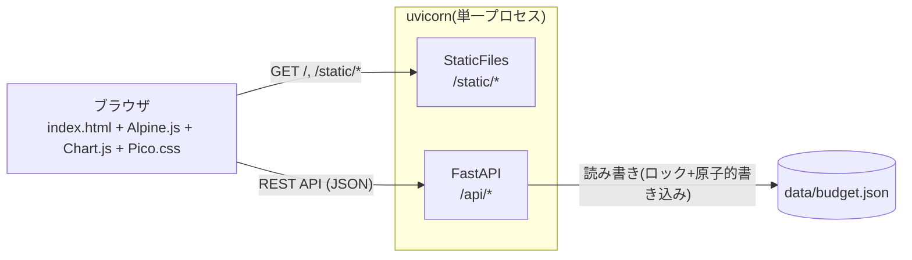

# 00. 基本設計(前提の整理)

| 項目 | 内容 |
|---|---|
| 文書ID | BD |
| 対象 | Budget Tracker(家計・サブスク管理Webアプリ) |
| 版 | 1.0(工程1) |

> 本書は、発注者から基本設計の入力がない前提で「仮定した基本設計」と「工程1着手前の合意事項」をまとめたものです。
> 詳細設計(01〜09)はすべて本書を前提とします。

---

## 1. システム概要

固定費・サブスクを把握し、月ごとの支出を集計する、個人利用(単一ユーザー)のWebアプリ。

- 認証なし。外部サービス・有料APIは使わず、ローカル(オフライン)で動作する
- バックエンド(FastAPI)が API と静的ファイル(HTML/CSS/JS)を同じプロセスで配信する
- データは JSON ファイル1つに保存する(DBは使わない)

## 2. 技術スタック

| 区分 | 採用技術 | 備考 |
|---|---|---|
| 言語 | Python 3.15 | uv で管理 |
| Web/API | FastAPI / uvicorn | 静的ファイル配信も担当 |
| 入出力モデル | Pydantic v2 | API設計のJSONスキーマと1対1 |
| テスト | pytest / pytest-cov / httpx(TestClient) | |
| フロント | HTML5 / CSS / JavaScript(ES Modules、ビルドなし) | |
| フロントライブラリ | Alpine.js / Chart.js / Pico.css | `static/vendor/` に同梱(CDN不使用) |
| JSテスト | Node.js LTS(`node --test`) | npmパッケージは使わない |
| データ | JSONファイル | `data/budget.json` |

## 3. 機能一覧(基本設計の仮定)

| No | 機能 | 概要 |
|---|---|---|
| F1 | 支出管理 | 登録・編集・削除・一覧(日付、金額、カテゴリ、メモ) |
| F2 | カテゴリ管理 | 固定カテゴリ + ユーザー追加。使用中・固定カテゴリは削除不可 |
| F3 | サブスク管理 | 名称、金額、周期(月次/年次)、次回更新日、有効/停止 |
| F4 | 更新日通知 | 今日から7日以内に更新日を迎えるもの(および超過分)をアプリ内に表示 |
| F5 | 月次集計 | カテゴリ別合計、前月比、サブスク合計(月額換算)、グラフ |
| F6 | 予算・超過警告 | 全体予算・カテゴリ別予算。80%以上で注意、100%超で警告 |
| F7 | CSVインポート | 支出の一括取り込み。不正行はスキップして結果を報告 |
| F8 | 多言語対応 | 英語(デフォルト)/日本語。表示形式も切り替える |

## 4. 画面一覧(概要)

| 画面ID | 画面名 | 主な機能 |
|---|---|---|
| SCR-00 | 共通レイアウト | ナビゲーション、言語切替、データ復旧の警告、エラー表示 |
| SCR-01 | ダッシュボード | 今月の集計、グラフ、予算警告、更新予定 |
| SCR-02 | 支出一覧 | 支出の一覧・登録・編集・削除 |
| SCR-03 | サブスク一覧 | サブスクの一覧・登録・編集・削除・停止/再開・更新済み |
| SCR-04 | 予算・カテゴリ設定 | 予算設定、カテゴリの追加・削除 |
| SCR-05 | CSVインポート | CSVの取り込みと結果レポート |

## 5. 非機能要件(基本設計の仮定)

| No | 要件 |
|---|---|
| N1 | API応答 500ms以内(支出5,000件の規模で) |
| N2 | 不正入力はすべて 4xx で返す(統一エラー形式) |
| N3 | データファイルが破損していても起動できる |
| N4 | ネットワーク未接続でも全画面を表示・操作できる |

## 6. 工程1着手前の合意事項

| ID | 合意事項 | 理由 |
|---|---|---|
| AD-01 | JSの単体テストは `node --test` で行う(npmパッケージは使わない) | 依存ゼロで、フレームワーク不使用の方針を保てる |
| AD-02 | Alpine.js(`cdn.min.js`)と Chart.js(`chart.umd.min.js`)は通常の `<script>` で読み込む。自作コードは ES Modules とし、`alpine:init` で `Alpine.data()` を登録する | Chart.js の ESM版は外部パッケージを素の import 名で参照しており、ビルドなしでは動かないため |
| AD-03 | 固定カテゴリは翻訳キー(`category.food` など)で表示し、ユーザー追加カテゴリは入力名をそのまま表示する | 固定カテゴリは言語に追従させ、ユーザーの入力は尊重する |
| AD-04 | 円グラフは上位7カテゴリ+「その他」に集約する。集約はバックエンドで行う | 集計は業務ルールのため、フロントには置かない |
| AD-05 | 月次の棒グラフは、今月を含む直近6か月とする | 半年分の傾向が見え、ラベルも読める本数 |
| AD-06 | 支出は日付のみで持つ(時刻なし)。タイムゾーンは Asia/Tokyo 固定。「今日」は Clock から注入する | 手入力・CSVで時刻を求めない。月の境界判定はテストで固定できるようにする |
| AD-07 | サブスクは「更新済み」操作で次回更新日を進める。基準日(anchor_day)を保存する。月次集計のサブスク合計は月額換算(年次は÷12で切り捨て)。サブスクは支出として自動計上せず、予算判定の対象外とする | 31日→30日の繰り越しで日付がずれていくのを防ぐ。二重計上を防ぐ |
| AD-08 | 予算は全体1件+カテゴリ別を1セットだけ持ち、毎月同じものを使う | 機能を最小にとどめる |
| AD-09 | CSVの重複は「日付・金額・カテゴリ・メモがすべて一致」で判定する。ファイル内・既存データの両方と照合し、重複行はスキップする | 同じCSVの二重取り込みを防ぐ |
| AD-10 | CSVの上限は 1MB かつ 5,000行。超えたら取り込み前に 413 で拒否する | 応答時間(N1)とメモリを守る |
| AD-11 | データは `data/budget.json` の1ファイルにまとめる | カテゴリ使用中チェックと削除を1回のロックの中で整合させる |
| AD-12 | `threading.Lock` + 一時ファイル書き込み + `os.replace` で書き込む。uvicorn は単一プロセスで動かす前提 | 同時リクエストでもファイルが壊れたり更新が失われたりしない |
| AD-13 | 破損ファイルは `budget.json.corrupt-<時刻>` に退避し、初期データで起動して画面に警告する | 起動不能を避けつつ、元データは失わない |
| AD-14 | 金額は 1〜9,999,999円の整数。予算は 0〜99,999,999円で、0 は「未設定」として扱う | 浮動小数点を使わない。入力ミスを上限で止める |
| AD-15 | IDは種類ごとの連番に接頭辞を付ける(`exp-000001` 形式)。削除したIDは再利用しない | 読みやすく、削除後に別データと取り違えない |
| AD-16 | uv init が生成したルートの `main.py` は削除する(工程2) | エントリポイントは `app/main.py` に統一する |
| AD-17 | 設計書は日本語。コード・コメント・docstring・コミット件名は英語。docstringには設計IDを書く(例:`[BR-03]`) | 設計書とコードの対応を追えるようにする |

## 7. 対象外(本プロジェクトでは実装しない)

- 認証・複数ユーザー、クラウド同期
- 通貨換算(JPY以外)
- サブスクの支払履歴の保持、支出への自動計上
- メール・プッシュ通知(通知はアプリ内表示のみ)
- 対象外の項目は、拡張案として各設計書の末尾と README の「将来の拡張案」にまとめる
