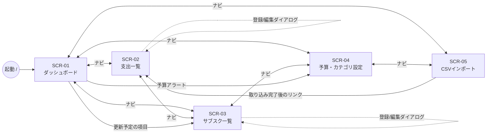

# 02. 画面設計

## 1. 画面一覧

| 画面ID | 画面名 | ハッシュ | Alpineコンポーネント | ファイル |
|---|---|---|---|---|
| SCR-00 | 共通レイアウト | (全画面共通) | `$store.app`, `$store.i18n` | index.html, js/main.js, js/router.js |
| SCR-01 | ダッシュボード | `#/dashboard`(既定) | `dashboardPage` | js/pages/dashboard.js |
| SCR-02 | 支出一覧 | `#/expenses` | `expensesPage` | js/pages/expenses.js |
| SCR-03 | サブスク一覧 | `#/subscriptions` | `subscriptionsPage` | js/pages/subscriptions.js |
| SCR-04 | 予算・カテゴリ設定 | `#/budgets` | `budgetsPage` | js/pages/budgets.js |
| SCR-05 | CSVインポート | `#/import` | `csvImportPage` | js/pages/csv-import.js |

- 単一の `index.html` に全画面のセクションを置き、表示中の画面だけを `x-show` で出す。
- 未定義のハッシュや空のハッシュは `#/dashboard` に置き換える(`history.replaceState`)。
- **カテゴリ管理を SCR-04 に置く理由**:予算とカテゴリはどちらも「カテゴリごとの一覧」であり、1つの表で扱えるため。
  基本設計の画面数を増やさずに済む。

## 2. 画面遷移図

- ナビゲーションは全画面に表示しており、どの画面からでもどの画面へも移動できる(図では一部の矢印を省略)。
- 登録・編集・削除の確認は `<dialog>` 要素で行う。
  - 理由:`window.confirm` は文言を翻訳できず、自動テストも止めてしまうため。

## 3. 共通レイアウト(SCR-00)

| No | 項目 | 種類 | 内容 |
|---|---|---|---|
| 00-1 | アプリ名 | 表示 | `app.title` |
| 00-2 | ナビゲーション | リンク | Dashboard / Expenses / Subscriptions / Budgets / Import。表示中の画面には `aria-current="page"` を付ける |
| 00-3 | 言語切替 | ボタン×2 | `EN` / `日本語`。選択中のボタンに `aria-pressed="true"`。このボタンの表記だけは翻訳しない(どちらの言語でも読めるように) |
| 00-4 | データ復旧の警告 | バナー | `GET /api/status` の `data_recovered=true` のとき表示する。`banner.data_recovered`(退避ファイル名を埋め込む)。閉じるボタンあり(閉じた状態はセッション中だけ保持) |
| 00-5 | 通知(トースト) | 表示 | 操作の成功・失敗を表示し、4秒後に消える。`role="status"` |
| 00-6 | 読み込み中 | 表示 | API呼び出し中は対象の領域に `aria-busy="true"` を付ける(Pico.css がスピナーを表示する) |

## 4. 言語切替の仕様(REQ-020〜022)

| 項目 | 仕様 |
|---|---|
| 対応言語 | `en`(既定)、`ja` |
| 初期言語 | localStorage `budgetTracker.lang` の値が `en` / `ja` ならそれを使い、それ以外は `en`。ブラウザの言語設定は参照しない(基本設計で既定を英語と決めているため) |
| localStorage 不可 | 読み書きの例外は握りつぶして `en` で動かす(プライベートモード対策) |
| 辞書 | `/static/i18n/{lang}.json` を fetch し、一度読んだ言語は保持して再取得しない。キーはドット区切りの階層(`nav.dashboard`) |
| 文言の取得 | `t(key, params)`。`{name}` の形の埋め込みに対応する。キーがなければ en の値、それもなければキー文字列そのものを表示する(画面が壊れず、欠落にすぐ気づける) |
| 切替時の処理 | ① 辞書を読み込む ② `$store.i18n.lang` を更新(Alpine が表示中の文言を再描画)③ `<html lang>` を更新 ④ localStorage に保存 ⑤ `i18n:changed` イベントを発行し、ダッシュボードがグラフを作り直す |
| 再取得 | 言語を切り替えても API を再呼び出ししない(APIの応答は言語に依存しないため) |
| ページタイトル | `<title>` も `app.title` で切り替える |

### 表示形式(format.js、REQ-021)

| 関数 | en | ja |
|---|---|---|
| formatMoney(1200) | `¥1,200` | `1,200円` |
| formatMoney(-1200)(前月比の差額) | `-¥1,200` | `-1,200円` |
| formatSignedMoney(1200) | `+¥1,200` | `+1,200円` |
| formatDate("2026-10-23") | `Oct 23, 2026` | `2026年10月23日` |
| formatMonth("2026-10") | `Oct 2026` | `2026年10月` |
| formatRate("12.5") / ("-6.3") / (null) | `+12.5%` / `-6.3%` / `—` | 同じ |
| formatPercent(93)(使用率) | `93%` | `93%` |

- 実装には `Intl.NumberFormat` と `Intl.DateTimeFormat` を使う(ロケールは en は `en-US`、ja は `ja-JP`)。
- 日付文字列は `Date.UTC` で組み立て、`timeZone: "UTC"` で整形する。
  - 理由:ブラウザのタイムゾーンによって日付が1日ずれるのを防ぐため。
- 整形関数は計算をせず、APIの値をそのまま書式化するだけにする(NFR-007)。

### エラー表示(REQ-022)

| 種類 | 表示場所 | 翻訳キー |
|---|---|---|
| 項目エラー(VALIDATION_ERROR の details) | 該当入力欄の下(`aria-invalid="true"` と `<small>`) | `errors.field.<code>`(params を埋め込む) |
| 業務エラー(409など) | トースト | `errors.<code>` |
| 画面データの読み込み失敗 | 画面内のエラー枠 + 再読み込みボタン | `errors.<code>` + `common.retry` |
| 通信失敗(fetch の例外) | トースト / エラー枠 | `errors.NETWORK_ERROR`(フロントだけで使うコード) |
| 未知のコード | 同上 | `errors.UNKNOWN` |

- 言語を切り替えると、表示中のエラーも新しい言語に変わる。
  エラーは文言ではなく「コード+params」として状態に持ち、表示するたびに `t()` を通すため。

## 5. 画面ごとの項目定義

> 入力制約はHTMLの属性(required / min / max / maxlength)でも付けるが、これは補助にすぎない。
> 最終的な判定はAPI(03_api_design.md)で行い、APIの項目エラーを画面に表示する。

### SCR-01 ダッシュボード

| No | 項目 | 種類 | 内容・データ元 |
|---|---|---|---|
| 01-1 | 対象月 | 表示 + ボタン(◀ ▶) | formatMonth。初期値は `status.current_month`。◀ は summary.previous_month へ、▶ は summary.next_month へ移動する。表示月が `status.current_month` と等しいときは ▶ を無効にする |
| 01-2 | 今月の支出合計 | 表示 | summary.total(formatMoney) |
| 01-3 | 前月比 | 表示 | summary.change_amount(formatSignedMoney)と change_rate(formatRate)。前月が0円なら「—」と `summary.no_previous` |
| 01-4 | 全体予算 | 表示 + 進捗バー | overall_budget(使用率・status の色。none なら「未設定」とSCR-04へのリンク) |
| 01-5 | サブスク合計(月額換算) | 表示 | subscriptions.monthly_total、active_count |
| 01-6 | 予算アラート | 一覧 | alerts。`caution` は黄、`over` は赤。文言は `alert.caution` / `alert.over`(カテゴリ名・使用率を埋め込む)。0件なら非表示 |
| 01-7 | 更新予定 | 一覧 | upcoming.items。名称、金額、日付、残り日数(`upcoming.in_days` / `upcoming.today` / `upcoming.overdue`)。0件なら `upcoming.none` |
| 01-8 | カテゴリ別円グラフ | グラフ | category-breakdown(6章 CH-01) |
| 01-9 | 月次推移の棒グラフ | グラフ | monthly-trend(6章 CH-02) |
| 01-10 | カテゴリ別一覧 | 表 | summary.categories(カテゴリ名、合計、前月比、予算、使用率、status) |

- 前月・翌月の値はフロントで計算せず、API-21 の `previous_month` / `next_month` を使う(BR-02 をフロントに書かないため)。
  ▶ を無効にする判定は文字列が等しいかを見るだけなので、業務ルールには当たらない。

### SCR-02 支出一覧

| No | 項目 | 種類 | 入力制約 / 内容 |
|---|---|---|---|
| 02-1 | 対象月 | 入力(`type="month"`) | 初期値は current_month。変更すると API-05 を再取得する |
| 02-2 | 月合計・件数 | 表示 | total, count |
| 02-3 | 一覧 | 表 | 日付(formatDate)、カテゴリ名、金額(formatMoney、右寄せ)、メモ、編集・削除ボタン。0件なら `expenses.empty` |
| 02-4 | 追加ボタン | ボタン | 登録ダイアログを開く |
| 02-5 | 日付 | 入力(`type="date"`) | 必須。min=2000-01-01、max=2099-12-31。初期値は status.today |
| 02-6 | 金額 | 入力(`type="number"`) | 必須。min=1、max=9999999、step=1。送信前に `Number()` で数値にする(文字列のまま送らない) |
| 02-7 | カテゴリ | 選択(`select`) | 必須。API-02 の結果を表示する |
| 02-8 | メモ | 入力(`text`) | 任意。maxlength=100 |
| 02-9 | 保存 / キャンセル | ボタン | 新規は POST、編集は PUT。成功したらダイアログを閉じて一覧を再取得 |
| 02-10 | 削除確認 | ダイアログ | 「削除しますか」→ DELETE。成功したら一覧を再取得 |

### SCR-03 サブスク一覧

| No | 項目 | 種類 | 入力制約 / 内容 |
|---|---|---|---|
| 03-1 | 一覧 | 表 | 名称、金額、周期(`cycle.monthly` / `cycle.yearly`)、月額換算、次回更新日、状態(`status.active` / `status.paused`)、操作ボタン |
| 03-2 | 更新予定バッジ | 表示 | upcoming に含まれる行に「あと◯日」「期限超過」を表示する |
| 03-3 | 操作ボタン | ボタン | 編集、停止 / 再開(状態に応じてどちらか)、更新済み(active のときだけ有効)、削除 |
| 03-4 | 名称 | 入力 | 必須。maxlength=50 |
| 03-5 | 金額 | 入力(number) | 必須。1〜9999999 |
| 03-6 | 周期 | 選択 | monthly / yearly |
| 03-7 | 次回更新日 | 入力(date) | 必須。2000-01-01〜2099-12-31 |
| 03-8 | 更新済みの確認 | ダイアログ | 「次回更新日を進めますか」。成功したら新しい日付をトーストで表示する |

- 「更新済み」ボタンは、7日より先のサブスクでも押せる(無効化しない)。
  押すと API が 409 SUBSCRIPTION_RENEW_TOO_EARLY を返し、その文言を表示する。
  - 理由:無効にするかどうかを画面で判定すると、BR-03 をフロントにも書くことになるため。

### SCR-04 予算・カテゴリ設定

| No | 項目 | 種類 | 入力制約 / 内容 |
|---|---|---|---|
| 04-1 | 全体予算 | 入力(number) | 任意。0〜99999999。空欄は null(未設定) |
| 04-2 | カテゴリ別予算の表 | 表 + 入力 | 全カテゴリの行。カテゴリ名、予算(0〜99999999、空欄は未設定)、削除ボタン |
| 04-3 | 予算の保存 | ボタン | 04-1 と 04-2 をまとめて PUT /api/budgets で送る |
| 04-4 | カテゴリ追加 | 入力 + ボタン | 名前は必須で maxlength=30。POST /api/categories |
| 04-5 | カテゴリ削除 | ボタン | 固定カテゴリと `in_use=true` のカテゴリは無効にし、`title` で理由(`categories.fixed` / `categories.in_use`)を示す。それでも 409 が返った場合(別タブで登録された場合など)はトーストで表示する |

- 削除ボタンの無効化は API の `is_fixed` / `in_use` を表示に反映するだけで、判定そのものはしていない。

### SCR-05 CSVインポート

| No | 項目 | 種類 | 内容 |
|---|---|---|---|
| 05-1 | 形式の説明 | 表示 | 列定義(CSV-01)と例、対応する文字コード、上限(1MB・5,000行) |
| 05-2 | ファイル選択 | 入力(`type="file" accept=".csv,text/csv"`) | 必須 |
| 05-3 | 取り込みボタン | ボタン | ファイルが選ばれるまで無効。送信中は二重送信を防ぐため無効にする |
| 05-4 | 結果の要約 | 表示 | encoding、total_rows、imported_count、error_count、duplicate_count。imported_count=0 なら警告の色にする |
| 05-5 | エラー一覧 | 表 | 行番号、列、内容(`csv.row.<code>`)、値。0件なら非表示 |
| 05-6 | 支出一覧へのリンク | リンク | imported_count > 0 のとき表示 |
| 05-7 | ファイルエラー | 表示 | 400 / 413 / 415 のエラーコードを翻訳して表示する |

## 6. グラフ仕様

| ID | CH-01 カテゴリ別構成 | CH-02 月次推移 |
|---|---|---|
| 種類 | 円グラフ(`pie`) | 棒グラフ(`bar`、縦) |
| データ元 | API-22 | API-23 |
| 系列 | 1系列(items の amount) | 1系列(items の total)。系列名 `chart.total` |
| ラベル | カテゴリ名(key があれば `t(key)`、なければ name) | formatMonth(month) |
| 凡例 | 表示(下)。カテゴリ名 | 非表示(1系列のため) |
| ツールチップ | `カテゴリ名: formatMoney(amount) (ratio_percent%)` | `formatMonth: formatMoney(total)` |
| 軸 | なし | Y軸の目盛りを formatMoney で表示し、0から始める |
| 色 | `charts/chart-config.js` に固定パレット8色を持ち、items の順に割り当てる。kind=other は灰色 | 単色 |
| 0件のとき | items が空ならグラフを描かず `chart.no_data` を表示する | 6か月すべて0円ならグラフを描かず `chart.no_data` を表示する |
| 1件のとき | 1色の円(100.0%) | 通常どおり |
| カテゴリが多いとき | APIで上位7件+その他(最大8件)にまとめ済み | 対象外 |
| 金額が極端なとき | 1円と9,999,999円が並ぶと扇形が見えないが、凡例とツールチップで確認できる | Y軸は Chart.js の自動目盛り。大きな値も formatMoney で桁区切り表示 |
| 言語切替時 | `i18n:changed` を受けて chart.destroy() → 新しい言語の設定で作り直す | 同左 |
| アクセシビリティ | `<canvas role="img" aria-label>` に要約文(`chart.breakdown_label`)を入れる | 同左(`chart.trend_label`) |

- 「6か月すべて0円か」の判定は、表示を出し分けるためだけのもので、集計ではない。
  `chart-config.js` の純粋関数 `isAllZero(items)` として実装し、単体テストの対象にする。
- `chart-config.js` の関数は「APIの応答+翻訳関数+整形関数 → Chart.js の設定オブジェクト」を返すだけにする。
  Chart.js を呼ぶのは `chart-render.js` だけ。

## 7. Alpine.js コンポーネントの状態と呼び出すAPI

共通ストア(main.js で登録):

| ストア | 保持する状態 | 呼び出すAPI / 処理 |
|---|---|---|
| `$store.i18n` | `lang`, `dict`(読み込み済みの辞書), `t()` | `/static/i18n/{lang}.json` |
| `$store.app` | `route`, `status`(StatusOut), `toast`, `bannerDismissed` | API-01(起動時に1回) |

| コンポーネント | 保持する状態 | 呼び出すAPI | 備考 |
|---|---|---|---|
| `dashboardPage` | `month`, `summary`, `upcoming`, `breakdown`, `trend`, `loading`, `error` | API-21, 18, 22, 23(並行して呼ぶ) | グラフのインスタンスはコンポーネントの外に保持する(Alpine の proxy でラップされると Chart.js が誤作動するため) |
| `expensesPage` | `month`, `list`, `categories`, `form`(id, date, amount, category_id, memo), `fieldErrors`, `dialogOpen`, `deleteTarget`, `loading`, `error` | API-05, 02, 06, 08, 09 | |
| `subscriptionsPage` | `items`, `upcomingIds`, `form`, `fieldErrors`, `dialogOpen`, `confirmTarget`(renew / delete), `loading`, `error` | API-10, 18, 11, 13, 14, 15, 16, 17 | |
| `budgetsPage` | `categories`, `budgetForm`(overall, byCategory{id: 値}), `newCategoryName`, `fieldErrors`, `loading`, `error` | API-02, 19, 20, 03, 04 | |
| `csvImportPage` | `file`, `uploading`, `report`, `error` | API-24 | |

- 各ページは表示されたとき(`route` が変わったとき)にデータを取り直す。
  - 理由:別の画面で行った変更(支出の登録など)を必ず反映させるため。
- コンポーネント内では計算をしない(集計・判定・日付計算は API の値を使う)。
  行うのは、入力値を数値・null に変換すること、表示用に整形関数を呼ぶことだけ。
