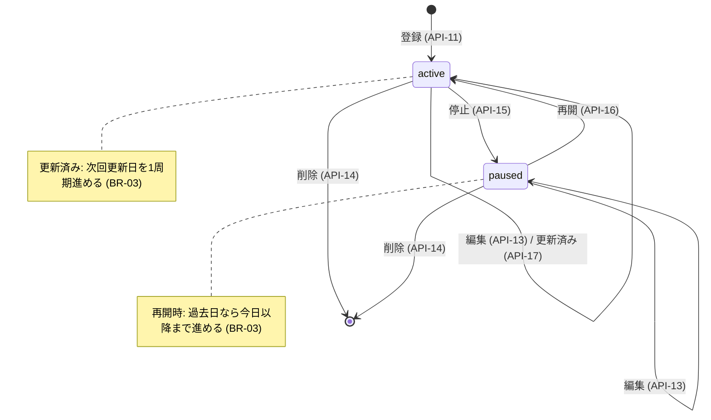

# 04. データ設計

| ID | 内容 |
|---|---|
| DATA-01 | ファイル構成と保存方式 |
| DATA-02 | JSONファイルの構造(スキーマ) |
| DATA-03 | IDの採番ルール |
| DATA-04 | サブスクの状態遷移 |
| DATA-05 | 固定カテゴリのマスタ |
| DATA-06 | 初期データ・サンプルデータ |

---

## DATA-01 ファイル構成と保存方式

| パス | 用途 | Git |
|---|---|---|
| `data/budget.json` | 実データ(1ファイルにすべて保存) | 対象外 |
| `data/budget.json.tmp` | 書き込み用の一時ファイル | 対象外 |
| `data/budget.json.corrupt-YYYYMMDDHHMMSS` | 破損ファイルの退避先(ERR-30) | 対象外 |
| `data/sample.json` | サンプルデータ | **対象** |

- データファイルのパスは環境変数 `BUDGET_DATA_FILE` で変更できる。既定値は `data/budget.json`。
  テストでは pytest の `tmp_path` に差し替える。
- `.gitignore` に `data/*.json.tmp` と `data/*.corrupt-*` を追加する(工程2)。

### 書き込み手順(AD-12)

```
with lock:                                  # threading.Lock(プロセス内で1つ)
    data = load()                           # 読み込み + Pydanticで検証
    ...変更...
    write(tmp, json.dumps(data, ensure_ascii=False, indent=2))
    flush + os.fsync(tmp)
    os.replace(tmp, budget.json)            # 同じディレクトリ内なので原子的に置き換わる
```

- **なぜ読み込みから書き込みまでを1つのロックで囲むか**:2つのリクエストが同時に読み込んで別々に保存すると、
  片方の更新が失われる(lost update)ため。
- 前提:uvicorn は単一プロセスで起動する(`--workers` を指定しない)。
  - 理由:複数プロセスでは threading.Lock が効かない。この前提を README に明記する。

## DATA-02 JSONファイルの構造

```json
{
  "schema_version": 1,
  "sequences": { "expense": 3, "category": 9, "subscription": 2 },
  "categories": [
    { "id": "cat-000001", "code": "food", "name": null, "is_fixed": true },
    { "id": "cat-000009", "code": null, "name": "Pets", "is_fixed": false }
  ],
  "expenses": [
    { "id": "exp-000001", "date": "2026-10-01", "amount": 1200,
      "category_id": "cat-000001", "memo": "Lunch" }
  ],
  "subscriptions": [
    { "id": "sub-000001", "name": "Video streaming", "amount": 1490,
      "cycle": "monthly", "next_renewal_date": "2026-10-31",
      "anchor_day": 31, "anchor_month": null, "status": "active" }
  ],
  "budgets": {
    "overall": 150000,
    "categories": { "cat-000001": 40000 }
  }
}
```

### 項目定義

| エンティティ | 項目 | 型 | 必須 | 制約 |
|---|---|---|---|---|
| (ルート) | schema_version | int | ○ | 1 固定 |
| | sequences.{expense,category,subscription} | int | ○ | 0以上。最後に払い出した番号 |
| Category | id | str | ○ | `cat-\d{6}` |
| | code | str / null | | 固定カテゴリのみ。DATA-05のコード |
| | name | str / null | | ユーザーカテゴリのみ。1〜30文字 |
| | is_fixed | bool | ○ | |
| Expense | id | str | ○ | `exp-\d{6}` |
| | date | str(YYYY-MM-DD) | ○ | 2000-01-01〜2099-12-31 |
| | amount | int | ○ | 1〜9,999,999 |
| | category_id | str | ○ | 存在するカテゴリID |
| | memo | str | ○ | 0〜100文字(未入力は空文字) |
| Subscription | id | str | ○ | `sub-\d{6}` |
| | name | str | ○ | 1〜50文字 |
| | amount | int | ○ | 1〜9,999,999 |
| | cycle | str | ○ | `monthly` / `yearly` |
| | next_renewal_date | str(YYYY-MM-DD) | ○ | 2000-01-01〜2099-12-31 |
| | anchor_day | int | ○ | 1〜31 |
| | anchor_month | int / null | | yearly では 1〜12、monthly では null |
| | status | str | ○ | `active` / `paused` |
| Budgets | overall | int / null | | 1〜99,999,999(0は保存時に null へ正規化) |
| | categories | {category_id: int} | ○ | 値は 1〜99,999,999。未設定のカテゴリはキーを持たない |

### 整合性制約(読み込み時に検証し、違反があれば破損として扱う:ERR-30)

1. 各IDが一意である
2. `expenses[].category_id` と `budgets.categories` のキーが、すべて存在するカテゴリIDである
3. 固定カテゴリ(DATA-05の8件)がすべて存在する
4. `sequences` の値が、各エンティティの最大ID番号以上である

- ファイルの検証は Pydantic モデル `DataFile` で行う。読み込みと検証を同じモデルで済ませるため。

### カテゴリ削除時の連動

- 使用中(支出が1件でも参照している)のカテゴリは削除できない(409 CATEGORY_IN_USE)。
- 未使用のカテゴリを削除するときは、`budgets.categories` にある同じIDの予算も一緒に削除する。
  - 理由:予算は使用中の判定に含めない。予算だけが残ると、存在しないカテゴリへの参照になるため。

## DATA-03 IDの採番ルール

| 種類 | 形式 | 例 |
|---|---|---|
| 支出 | `exp-` + 6桁ゼロ埋め | exp-000001 |
| カテゴリ | `cat-` + 6桁ゼロ埋め | cat-000009 |
| サブスク | `sub-` + 6桁ゼロ埋め | sub-000001 |

```
next_id(kind):
  sequences[kind] += 1
  return f"{prefix}-{sequences[kind]:06d}"   # 999,999件を超えたら7桁になる(並び順は数値で比較)
```

- 番号は単調に増やし、削除したIDも再利用しない。
  - 理由:削除済みIDを指す古い画面から操作されたとき、別のデータを操作してしまう事故を防ぐため。
- 採番は書き込みロックの中で行う(DATA-01)。

## DATA-04 サブスクの状態遷移



| 現在 \ 操作 | 編集 | 停止 | 再開 | 更新済み | 削除 |
|---|---|---|---|---|---|
| active | ○ | ○ → paused | × 409 STATE_CONFLICT | ○(BR-03。7日より先なら409 RENEW_TOO_EARLY) | ○ |
| paused | ○ | × 409 STATE_CONFLICT | ○ → active | × 409 INACTIVE | ○ |

- 登録時は常に active。status は編集APIでは変えられず、停止・再開APIでのみ変わる。
  - 理由:状態遷移の入口を1か所にし、BR-03(再開時の繰り越し)を必ず通すため。

## DATA-05 固定カテゴリのマスタ

固定カテゴリは `app/domain/categories.py` に定数として定義する。初期化時と、ファイル読み込みで欠けていた場合の検証に使う。

| id | code | 翻訳キー | CSV照合用の別名(大文字小文字を区別しない) |
|---|---|---|---|
| cat-000001 | food | category.food | food, Food, 食費 |
| cat-000002 | daily_goods | category.daily_goods | daily_goods, Daily goods, 日用品 |
| cat-000003 | housing | category.housing | housing, Housing, 住居費 |
| cat-000004 | utilities | category.utilities | utilities, Utilities, 水道光熱費 |
| cat-000005 | transportation | category.transportation | transportation, Transportation, 交通費 |
| cat-000006 | communication | category.communication | communication, Communication, 通信費 |
| cat-000007 | entertainment | category.entertainment | entertainment, Entertainment, 娯楽費 |
| cat-000008 | other | category.other | other, Other, その他 |

- 翻訳キーは `"category." + code` で導出する。
- CSV照合用の別名はUIの文言ではなく「入力データの照合規則」なので、バックエンドに持つ。
  - 表示用の翻訳は `static/i18n/*.json` にあり、両者の表記を揃えることは翻訳キーのテスト(工程3)で確認する。
- ユーザーカテゴリの名前は、前後の空白を除いたうえで次と重複してはいけない(大文字小文字を区別しない)。
  - 既存のユーザーカテゴリ名
  - 固定カテゴリの別名
  - 重複した場合は 409 CATEGORY_NAME_DUPLICATED。理由:CSVの照合結果が一意に決まるようにするため。
- 円グラフの「その他(集約)」は `category.others` で、固定カテゴリの `category.other` とは別キーにする。

## DATA-06 初期データ・サンプルデータ

| ケース | 動作 |
|---|---|
| `budget.json` がない(初回起動) | 固定カテゴリ8件・空の支出/サブスク・予算未設定で作成する(警告なし) |
| 破損している | ERR-30 の手順で退避してから初期データを作成し、警告を出す |
| サンプルで試したい | `cp data/sample.json data/budget.json` を実行してから起動する(README に記載) |

- `data/sample.json` には、直近数か月分の支出(複数カテゴリ)、月次・年次・停止中のサブスク、
  予算(注意・警告が出る値)を含める。起動確認とスクリーンショット用である。
