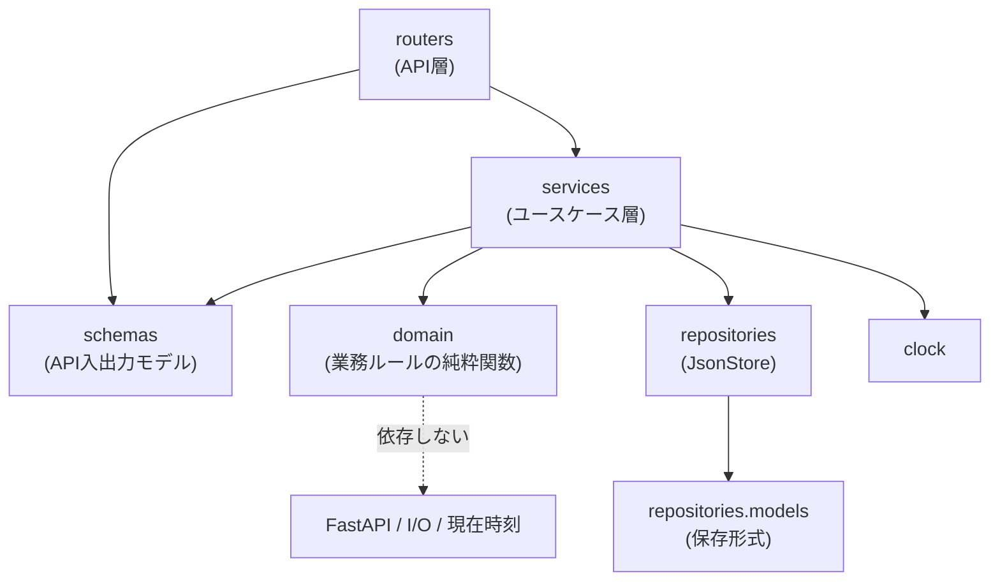
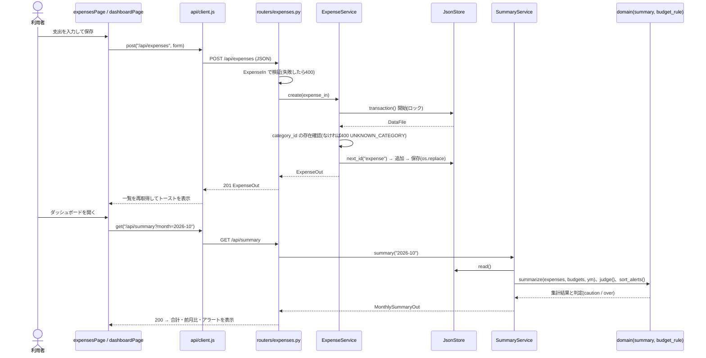
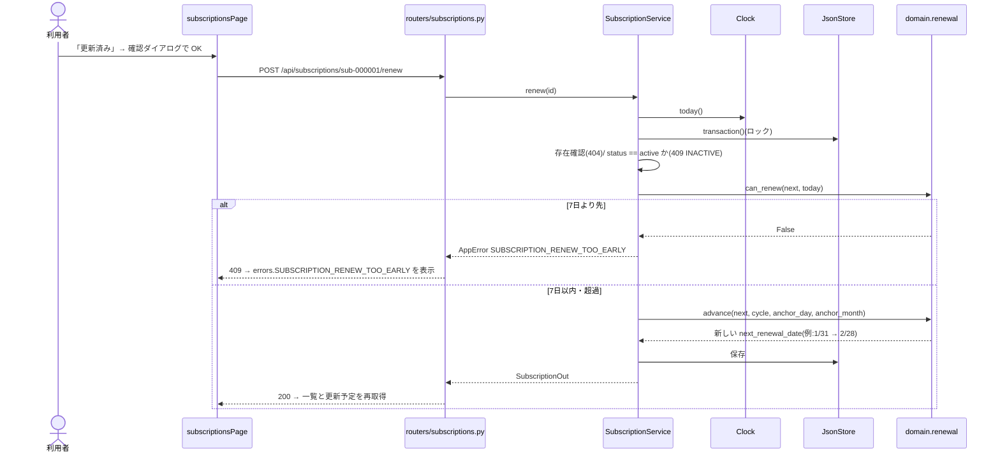
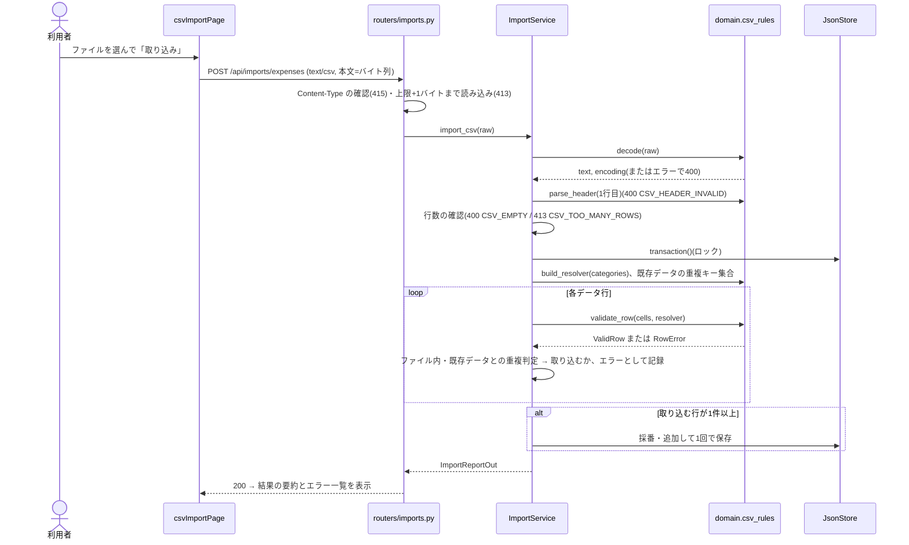

# 07. モジュール設計

| ID | 内容 |
|---|---|
| MOD-01 | ディレクトリ構成 |
| MOD-02 | レイヤ構成と依存の規則 |
| MOD-03 | バックエンドのモジュールと責務 |
| MOD-10 | Pydanticモデル一覧 |
| MOD-20 | 依存性注入(Clock・JsonStore) |
| MOD-30 | シーケンス図(主要3ユースケース) |
| MOD-40 | フロントエンドのファイル構成と責務 |

---

## MOD-01 ディレクトリ構成

```
Python-Budget-Tracker-App/
├── app/
│   ├── __init__.py
│   ├── main.py                 # create_app()、ルーター登録、static配信、例外ハンドラ、lifespan
│   ├── config.py               # Settings(データパス、TZ、上限値)
│   ├── clock.py                # Clock / SystemClock / FixedClock、get_clock
│   ├── errors.py               # AppError、エラーコード定数、例外ハンドラ、Pydanticエラーの変換
│   ├── dependencies.py         # get_store、各 service の生成(Depends)
│   ├── schemas/                # API入出力のモデル(MOD-10)
│   │   ├── common.py  category.py  expense.py  subscription.py
│   │   ├── budget.py  summary.py  chart.py  csv_import.py  status.py
│   ├── routers/                # API層
│   │   ├── status.py  categories.py  expenses.py  subscriptions.py
│   │   ├── budgets.py  summary.py  charts.py  imports.py
│   ├── services/               # ユースケース層
│   │   ├── category_service.py  expense_service.py  subscription_service.py
│   │   ├── budget_service.py  summary_service.py  import_service.py
│   ├── repositories/
│   │   ├── models.py           # 保存形式のモデル(DataFile ほか)
│   │   └── json_store.py       # JsonStore(ロック、原子的書き込み、破損からの復旧)
│   └── domain/                 # 業務ルールの純粋関数(05)
│       ├── money.py  period.py  renewal.py  budget_rule.py
│       ├── summary.py  categories.py  csv_rules.py
├── static/                     # MOD-40
├── data/sample.json
├── docs/
└── tests/
    ├── conftest.py             # tmp_path の JsonStore、FixedClock、TestClient
    ├── unit/                   # domain、schemas、errors、json_store
    ├── integration/            # TestClient による API 結合テスト
    ├── js/                     # *.test.mjs(node --test)
    └── fixtures/csv/
```

## MOD-02 レイヤ構成と依存の規則



| レイヤ | 責務 | してはいけないこと |
|---|---|---|
| routers | HTTPと schemas の変換、Depends による注入、ステータスコードの指定 | 業務判定、ファイル操作 |
| services | 1つのユースケースを1つのトランザクション(ロック)で実行する。存在確認、AppError の送出、保存形式 ↔ API形式の変換 | HTTPの知識(Request、ステータスコード以外) |
| domain | 05・06 の規則の計算(引数 → 戻り値) | I/O、例外による制御(ERR-10)、`date.today()` の呼び出し |
| repositories | ファイルの読み書き、ロック、採番、破損からの復旧 | 業務判定 |

- **なぜこの依存方向か**:最も重要な domain を最も依存の少ない場所に置くことで、単体テストをフレームワークなしで書けるようにするため(NFR-007)。

## MOD-03 バックエンドのモジュールと責務

### domain(純粋関数)

| モジュール | 主な関数 | 設計ID |
|---|---|---|
| money.py | `monthly_equivalent(amount, cycle) -> int`、`parse_csv_amount(text) -> int \| str(エラーコード)` | BR-01, BR-04-1 |
| period.py | `parse_month`、`month_of`、`month_range`、`previous_month`、`next_month`、`last_n_months` | BR-02 |
| renewal.py | `last_day`、`advance`、`roll_forward(current, today, ...)`、`can_renew(next, today) -> bool`、`upcoming(subs, today, window=7)` | BR-03, BR-04-2 |
| budget_rule.py | `judge(spent, budget) -> BudgetStatus`、`usage_percent(spent, budget) -> int \| None` | BR-05 |
| summary.py | `change_rate(cur, prev) -> Decimal \| None`、`totals_by_category(expenses, ym)`、`summarize(...)`、`breakdown(...)`、`trend(...)`、`sort_alerts(...)` | BR-06, BR-07 |
| categories.py | `FIXED_CATEGORIES`(DATA-05)、`build_resolver(categories) -> dict[str, str]`、`normalize_name(name)` | DATA-05 |
| csv_rules.py | `decode(raw)`、`parse_header(row)`、`validate_row(cells, resolver)`、`duplicate_key(row)` | CSV-02〜05 |

- 結果の型は `dataclass(frozen=True)` または `Enum` で表す(例:`BudgetStatus`、`RowError`)。

### services

| クラス | 主なメソッド | 呼ぶ domain |
|---|---|---|
| CategoryService | `list()`、`create(name)`、`delete(id)` | categories |
| ExpenseService | `list(month)`、`get(id)`、`create(in)`、`update(id, in)`、`delete(id)` | period |
| SubscriptionService | `list()`、`get`、`create`、`update`、`delete`、`pause`、`resume`、`renew`、`upcoming()` | renewal, money |
| BudgetService | `get()`、`replace(in)` | |
| SummaryService | `summary(month)`、`breakdown(month)`、`trend(month)` | summary, budget_rule, period, money |
| ImportService | `import_csv(raw: bytes, content_type)` | csv_rules, categories |

- Clock を必要とするサービスは、コンストラクタで Clock を受け取る。
- 書き込みを伴うメソッドは `with store.transaction() as data:` の中で処理を完結させる。

### repositories

| クラス / 関数 | 責務 |
|---|---|
| `JsonStore(path)` | `read() -> DataFile`(ロック内で読み込み、コピーを返す)、`transaction()`(ロック、読み込み、yield、保存)、`next_id(data, kind)`、`recovery_info` |
| `JsonStore.initialize()` | 起動時の読み込み・検証・復旧(ERR-30)と `.tmp` の削除 |
| `models.DataFile` ほか | 保存形式の Pydantic モデル(DATA-02)。整合性制約は `model_validator` で検証する |

### その他

| モジュール | 責務 |
|---|---|
| clock.py | `Clock`(Protocol:`today() -> date`)、`SystemClock`(Asia/Tokyo)、`FixedClock(date)` |
| errors.py | `AppError`、ハンドラ4種、`pydantic_errors_to_details()`(ERR-03 の対応表) |
| main.py | `create_app(settings)`。テストで設定を差し替えられるようにファクトリ関数にする。`app = create_app()` |

## MOD-10 Pydanticモデル一覧

### API入出力(`app/schemas/`)— 03_api_design.md 4章と1対1

| モデル | 用途 | API |
|---|---|---|
| ErrorDetail / ErrorBody / ErrorResponse | 統一エラー形式 | 全API(OpenAPI の responses にも登録する) |
| StatusOut | 状態 | API-01 |
| CategoryIn / CategoryOut / CategoryListOut | カテゴリ | API-02〜04 |
| ExpenseIn / ExpenseOut / ExpenseListOut | 支出 | API-05〜09 |
| SubscriptionIn / SubscriptionOut / SubscriptionListOut | サブスク | API-10〜17 |
| UpcomingItem / UpcomingListOut | 更新予定 | API-18 |
| CategoryBudgetItem / BudgetsIn / BudgetsOut | 予算 | API-19, 20 |
| BudgetStatusOut / CategorySummaryOut / SubscriptionTotalsOut / AlertOut / MonthlySummaryOut | 月次集計 | API-21 |
| BreakdownItem / CategoryBreakdownOut | 円グラフ | API-22 |
| TrendItem / MonthlyTrendOut | 棒グラフ | API-23 |
| ImportRowErrorOut / ImportReportOut | CSV結果 | API-24 |

共通の設定(入力モデル):

```python
class InputModel(BaseModel):
    model_config = ConfigDict(extra="forbid", str_strip_whitespace=True)
```

型エイリアス(`schemas/common.py`):

| 名前 | 定義 |
|---|---|
| `Amount` | `Annotated[StrictInt, Field(ge=1, le=9_999_999)]` |
| `BudgetAmount` | `Annotated[StrictInt, Field(ge=0, le=99_999_999)] \| None` |
| `AppDate` | `date` に AfterValidator で範囲検査を付けたもの(DATE_OUT_OF_RANGE) |
| `MonthStr` | `str` に AfterValidator で BR-02 の検査を付けたもの(INVALID_MONTH) |
| `RatePercent` | `Decimal \| None`(JSONでは文字列) |

- **入力モデルと保存モデルを分ける理由**:API(id を受け取らない、`monthly_equivalent` を返す)と、
  保存形式(`anchor_day` を持つ)では、必要な項目が違うため。
  1つのモデルで兼ねると、片方の変更がもう片方に波及する。

### 保存形式(`app/repositories/models.py`)— DATA-02

`DataFile`、`StoredCategory`、`StoredExpense`、`StoredSubscription`、`StoredBudgets`、`Sequences`

## MOD-20 依存性注入

```python
def get_clock() -> Clock: return SystemClock()
def get_store(request: Request) -> JsonStore: return request.app.state.store

# テスト
app.dependency_overrides[get_clock] = lambda: FixedClock(date(2026, 10, 31))
```

- JsonStore はアプリに1つだけ作り(lifespan で生成・初期化して `app.state` に置く)、ロックを共有する。
- **Clock をクラスにした理由**:テストで日付を自由に固定でき、月またぎの23:59/0:00も
  `SystemClock(now=lambda: datetime(...))` で再現できるため(BR-02)。

## MOD-30 シーケンス図

### UC-1 支出の登録 → 月次集計・予算警告(REQ-001, 012, 017)



### UC-2 サブスクの「更新済み」→ 次回更新日の再計算(REQ-010, 011)



### UC-3 CSVインポート(REQ-018, 019)



## MOD-40 フロントエンドのファイル構成と責務

```
static/
├── index.html                # 全画面のマークアップ。<script> の順:vendor(Chart, main.js[module], Alpine[defer])
├── vendor/
│   ├── alpine.min.js         # Alpine.js(cdn build)
│   ├── chart.umd.min.js      # Chart.js(UMD build)
│   ├── pico.min.css          # Pico.css
│   └── VERSIONS.md           # バージョン、取得元URL、SHA-256、ライセンス
├── css/custom.css            # Picoの上書きのみ(status の色、表の右寄せなど)
├── js/
│   ├── main.js               # alpine:init でストアと全ページを登録し、初期化(status・辞書の読み込み)
│   ├── router.js             # parseHash(hash) -> route(純粋関数)、hashchange の購読
│   ├── api/client.js         # request()、toApiError()(純粋関数)、get / post / put / del / postCsv
│   ├── i18n/
│   │   ├── i18n.js           # resolveKey(dict, key)・interpolate(純粋関数)、loadDictionary、setLang、localStorage
│   │   └── format.js         # formatMoney / formatSignedMoney / formatDate / formatMonth / formatRate / formatPercent(純粋関数)
│   ├── charts/
│   │   ├── chart-config.js   # buildBreakdownConfig / buildTrendConfig / isAllZero / categoryLabel(純粋関数)
│   │   └── chart-render.js   # renderChart(canvas, config)・destroy(Chart.js を呼ぶのはここだけ)
│   └── pages/
│       ├── dashboard.js  expenses.js  subscriptions.js  budgets.js  csv-import.js
│       └── shared.js         # 項目エラーの対応付け fieldErrorsFrom(apiError) など、画面共通の補助(純粋関数)
└── i18n/
    ├── en.json
    └── ja.json
```

| ファイル | 責務 | 単体テスト(工程3) |
|---|---|---|
| router.js | ハッシュ → 画面ID の対応付け、未定義のハッシュを dashboard にする | ○ parseHash |
| api/client.js | fetch のラッパー。エラーを ApiError に正規化する(ERR-20) | ○ toApiError、request(fetch をスタブにする) |
| i18n/i18n.js | 辞書の解決、埋め込み、フォールバック、言語の保存と復元 | ○ resolveKey / interpolate / 言語の初期値の決定 |
| i18n/format.js | 表示の整形(02 の4章) | ○ |
| charts/chart-config.js | API応答 → Chart.js の設定オブジェクト | ○ |
| charts/chart-render.js | 描画・破棄 | ×(結合テストで手動確認) |
| pages/*.js | Alpine コンポーネント(状態の保持とAPI呼び出し) | ×(結合テストで手動確認) |
| pages/shared.js | details → `{field: {code, params}}` の変換 | ○ |

### import の規則

- 純粋関数のモジュール(router / client / i18n / format / chart-config / shared)は、読み込んだ時点で `window`・`document`・`Alpine`・`Chart` に触れない。
  - 理由:Node(`node --test`)からそのまま import できるようにするため。
- `fetch`・`localStorage` は関数の引数で受け取れるようにし、テストで差し替えられるようにする(既定値はグローバルのもの)。
- グローバルの `Chart` / `Alpine` を参照してよいのは、chart-render.js・main.js・pages/ だけ。
- **読み込み順**:Alpine は `defer` で最後に読み込み、`alpine:init` で main.js の登録処理が先に走るようにする。
  ES Modules も遅延実行されるので、`main.js`(module)→ `alpine.min.js`(defer)の順に記述する。
