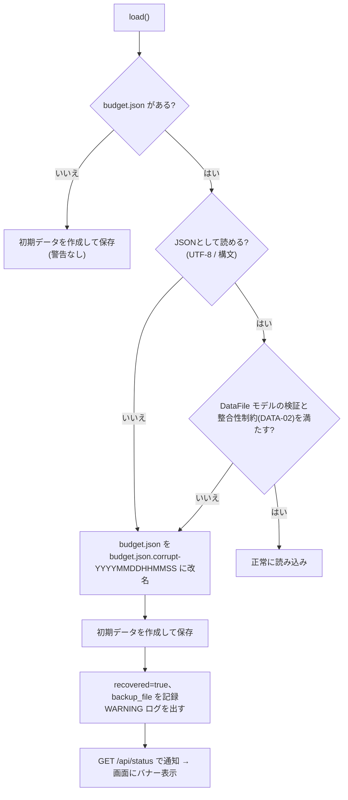

# 08. エラー処理設計

| ID | 内容 |
|---|---|
| ERR-01 | 統一エラー形式(03_api_design.md 2章) |
| ERR-02 | エラーコード一覧 |
| ERR-03 | 例外ハンドラ(03_api_design.md 2章) |
| ERR-10 | 業務例外の設計(AppError) |
| ERR-20 | フロントでのAPI失敗時の振る舞い |
| ERR-30 | データファイルの破損・欠損時の復旧 |
| ERR-31 | 書き込み失敗時の振る舞い |
| ERR-32 | ログ出力 |

---

## ERR-02 エラーコード一覧

### error.code(レスポンス全体のコード。翻訳キーは `errors.<code>`)

| コード | HTTP | 発生条件 | 英語の表示例 | 日本語の表示例 |
|---|---|---|---|---|
| VALIDATION_ERROR | 400 | 入力の検証エラー(details に項目ごとのエラー) | Please check the highlighted fields. | 入力内容を確認してください。 |
| INVALID_JSON | 400 | JSONとして解釈できない | Invalid request format. | リクエストの形式が正しくありません。 |
| NOT_FOUND | 404 | 未定義のパス | Not found. | 見つかりません。 |
| METHOD_NOT_ALLOWED | 405 | 許可されていないメソッド | Operation not allowed. | この操作はできません。 |
| HTTP_ERROR | その他 | その他のHTTPエラー | Request failed. | リクエストに失敗しました。 |
| EXPENSE_NOT_FOUND | 404 | 支出IDが存在しない | The expense no longer exists. | 支出が見つかりません(削除された可能性があります)。 |
| CATEGORY_NOT_FOUND | 404 | カテゴリIDが存在しない(API-04) | The category no longer exists. | カテゴリが見つかりません。 |
| SUBSCRIPTION_NOT_FOUND | 404 | サブスクIDが存在しない | The subscription no longer exists. | サブスクが見つかりません。 |
| CATEGORY_FIXED | 409 | 固定カテゴリを削除しようとした | Built-in categories cannot be deleted. | 固定カテゴリは削除できません。 |
| CATEGORY_IN_USE | 409 | 使用中のカテゴリを削除しようとした | This category is used by {count} expense(s). | このカテゴリは{count}件の支出で使用中です。 |
| CATEGORY_NAME_DUPLICATED | 409 | カテゴリ名が重複している | A category with this name already exists. | 同じ名前のカテゴリがあります。 |
| SUBSCRIPTION_STATE_CONFLICT | 409 | 停止中のものを停止・有効なものを再開しようとした | The subscription is already in that state. | すでにその状態です。 |
| SUBSCRIPTION_INACTIVE | 409 | 停止中のサブスクを「更新済み」にしようとした | Paused subscriptions cannot be renewed. | 停止中のサブスクは更新できません。 |
| SUBSCRIPTION_RENEW_TOO_EARLY | 409 | 次回更新日が今日から7日より先(params.days=7) | Renewal is available from {days} days before the date. | 更新日の{days}日前から操作できます。 |
| SUBSCRIPTION_DATE_LIMIT | 409 | 更新済み・再開で計算した次回更新日が 2099-12-31 を超える(工程2で追加) | The next renewal date would be after 2099-12-31. | 次回更新日が2099年12月31日を超えるため更新できません。 |
| CSV_UNSUPPORTED_MEDIA_TYPE | 415 | Content-Type が text/csv でない | Please upload a CSV file. | CSVファイルを指定してください。 |
| CSV_TOO_LARGE | 413 | 1MBを超える | The file is too large (max 1 MB). | ファイルが大きすぎます(上限1MB)。 |
| CSV_TOO_MANY_ROWS | 413 | 5,000行を超える | Too many rows (max {max}). | 行数が多すぎます(上限{max}行)。 |
| CSV_EMPTY | 400 | 0バイト・空白のみ・ヘッダーのみ | The file has no data. | データがありません。 |
| CSV_ENCODING_UNSUPPORTED | 400 | UTF-8 / Shift_JIS のどちらでも読めない | Unsupported encoding. Use UTF-8 or Shift_JIS. | 文字コードに対応していません(UTF-8またはShift_JIS)。 |
| CSV_HEADER_INVALID | 400 | ヘッダーの不足・未定義・重複。details[].field に列名、details[].code に MISSING_COLUMN / UNKNOWN_COLUMN / DUPLICATE_COLUMN | Invalid header row. | ヘッダー行が正しくありません。 |
| CSV_PARSE_ERROR | 400 | csv モジュールが解析できない(1つの値が csv.field_size_limit を超えるなど)。params.line に行番号(工程2で追加) | The CSV could not be read near line {line}. | {line}行目付近でCSVを読み取れませんでした。 |
| STORAGE_WRITE_FAILED | 500 | データファイルに書き込めない | Failed to save data. | データの保存に失敗しました。 |
| INTERNAL_ERROR | 500 | 想定外の例外 | Unexpected error occurred. | 予期しないエラーが発生しました。 |
| NETWORK_ERROR | (フロントのみ) | fetch 自体が失敗した | Cannot connect to the server. | サーバーに接続できません。 |
| UNKNOWN | (フロントのみ) | 辞書にないコード・JSONでない応答 | Something went wrong. | エラーが発生しました。 |

### details[].code(項目エラー。翻訳キーは `errors.field.<code>`)

| コード | 発生条件 | params | 英語の表示例 |
|---|---|---|---|
| FIELD_REQUIRED | 必須項目がない | | Required. |
| INVALID_TYPE | 型が違う(金額に小数・文字列など) | | Invalid value. |
| OUT_OF_RANGE | 数値が範囲外 | min, max | Must be between {min} and {max}. |
| TOO_SHORT | 文字数が足りない(空文字を含む) | min | Required. |
| TOO_LONG | 文字数が多すぎる | max | Up to {max} characters. |
| INVALID_DATE | 日付の形式が正しくない・存在しない日付 | | Invalid date. |
| DATE_OUT_OF_RANGE | 2000-01-01〜2099-12-31 の範囲外 | min, max | Date must be between {min} and {max}. |
| INVALID_MONTH | month クエリの形式・範囲が正しくない | | Invalid month. |
| INVALID_CHOICE | 選択肢にない値 | choices | Invalid choice. |
| UNKNOWN_FIELD | 未定義の項目 | | Unknown field. |
| UNKNOWN_CATEGORY | 存在しないカテゴリID | | Category does not exist. |
| DUPLICATED_CATEGORY | 予算で同じカテゴリが重複している | | Duplicated category. |
| INVALID_VALUE | その他 | | Invalid value. |

- CSVの行エラーコードは 06_csv_import_design.md の CSV-07 を参照(翻訳キーは `csv.row.<code>`)。
- **工程2で追加したコードの理由**
  - SUBSCRIPTION_DATE_LIMIT:範囲外の日付を保存すると、次回の読み込みで整合性違反(DATA-02)となり、データファイル全体が破損扱いになるため。保存の手前で止める。
  - CSV_PARSE_ERROR:csv モジュールの例外をそのままにすると 500 になり、NFR-002(不正入力は4xx)を満たせないため。
- 金額の範囲は OUT_OF_RANGE の params で受け取り、表示時に formatMoney で整形する(例:`¥1〜¥9,999,999`)。

## ERR-10 業務例外の設計

```python
class AppError(Exception):
    """[ERR-10] Business error converted to the unified error response."""
    def __init__(self, code: str, status: int, message: str, details: list[ErrorDetail] | None = None): ...

# 例:raise AppError("CATEGORY_IN_USE", 409, "Category is in use.",
#                  [ErrorDetail(field=None, code="CATEGORY_IN_USE", params={"count": 3})])
```

- よく使う例外は、専用の関数(`not_found("EXPENSE_NOT_FOUND")` など)で生成して、書き方を揃える。
- 業務例外は service 層で送出する。domain 層は例外を送出せず、結果の値(エラーコードを含む)を返す。
  router 層は例外を捕捉しない(例外ハンドラに任せる)。
  - 理由:domain 層の関数を「入力 → 出力」だけで検証できるようにするため。
    エラー応答への変換は例外ハンドラの1か所にまとめる。

## ERR-20 フロントでのAPI失敗時の振る舞い

`js/api/client.js` は、すべての失敗を次の `ApiError` に正規化する。

```js
// 成功時:解析済みのJSON(204 は null)を返す
// 失敗時:ApiError { status, code, details } を throw する
```

| 状況 | status | code | details |
|---|---|---|---|
| fetch が例外を投げた(オフライン・サーバー停止) | 0 | NETWORK_ERROR | [] |
| エラー応答の本文が統一エラー形式 | 応答の値 | error.code | error.details |
| エラー応答の本文がJSONでない・形式が違う | 応答の値 | UNKNOWN | [] |
| 成功応答の本文がJSONでない | 応答の値 | UNKNOWN | [] |

- 正規化を行う純粋関数 `toApiError(status, body)` は単体テストの対象にする。
- 画面での表示の振り分けは 02_screen_design.md の 4章「エラー表示」に従う。
- 書き込みに失敗したとき、フロントは自動で再送しない。
  - 理由:POST は冪等ではなく、再送すると二重登録になるおそれがあるため。

## ERR-30 データファイルの破損・欠損時の復旧(NFR-003)



| 項目 | 方針 |
|---|---|
| 検出のタイミング | アプリ起動時(lifespan)に1回読み込んで検証する。実行中に外部から壊された場合は、次の読み込み時に同じ手順で検出する |
| 一部だけ救済するか | しない(ファイル全体を退避する)。理由:一部だけ救済すると整合性(カテゴリ参照など)が崩れたデータで動いてしまうため。救済は拡張案 X-07 |
| 退避ファイル | 消さずに残す。利用者が手で中身を確認・修正し、`budget.json` に戻せばよい(README に手順を書く) |
| 退避ファイル名の重複 | 同じ秒に重複したら末尾に `-1`, `-2` を付ける |
| 一時ファイル `.tmp` が残っている | 書き込み途中で強制終了した跡。本体は `os.replace` 前の内容のままなので、起動時に `.tmp` を削除する |
| 改名できない(権限など) | CRITICAL ログを出して起動を中止する。理由:データを上書きして失うよりも、止めて気づかせるほうが安全なため。この場合だけ NFR-003 の例外とする |

## ERR-31 書き込み失敗時の振る舞い

- 一時ファイルの書き込み、または `os.replace` で `OSError` が出たら、一時ファイルを削除して `AppError("STORAGE_WRITE_FAILED", 500)` を送出する。
- 本体のファイルは置き換わっていないので、データは操作前の状態のまま残る(原子性)。

## ERR-32 ログ出力

| レベル | 出力する内容 |
|---|---|
| INFO | 起動時のデータファイルのパス、CSVインポートの件数 |
| WARNING | 破損ファイルの退避、4xxのうち 409 / 413 / 415 |
| ERROR | 500 エラー(スタックトレースを含む) |

- 標準の `logging` を使い、uvicorn のロガー設定に従う。
- 支出のメモなど、データの中身はログに出さない(個人の家計情報のため)。

---

## 将来の拡張案

- X-07:破損ファイルから、正常なレコードだけを救済して取り込むツール
